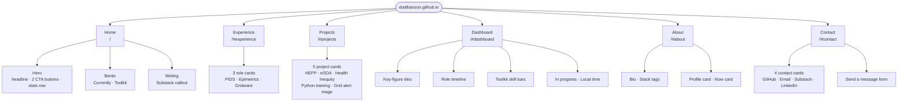
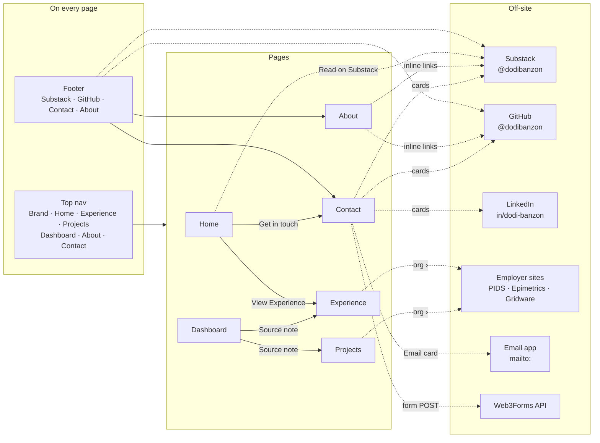
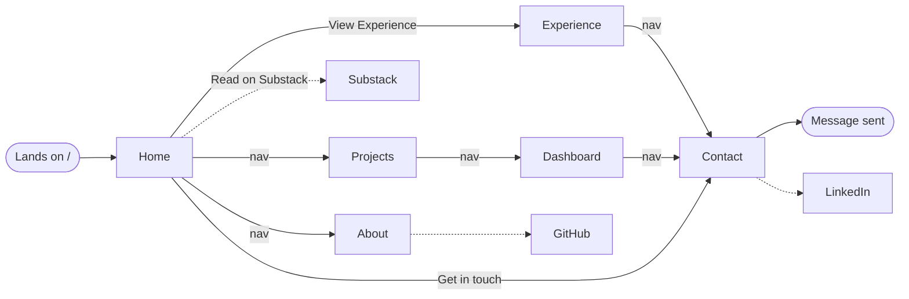
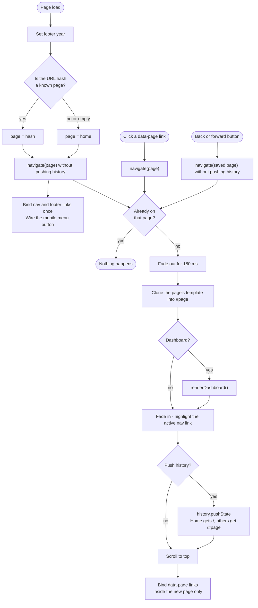
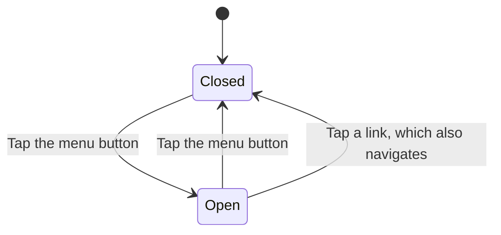
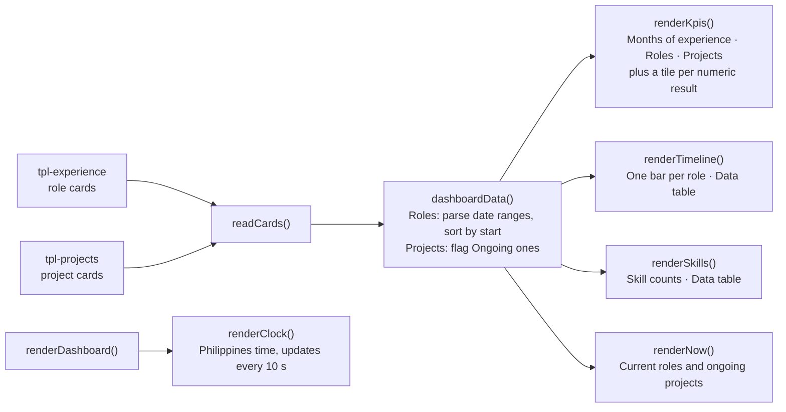
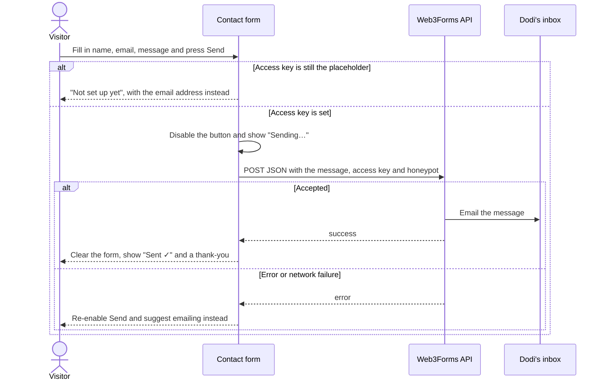

# Web flow

How visitors move through **dodibanzon.github.io**: every page, every link, and what happens behind each click. The whole site is one file, `index.html`. Pages are `<template>` elements that the router swaps into `#page`, so moving between pages never reloads the browser.

The diagrams are Mermaid, so GitHub draws them right in this file. In the diagrams, **solid arrows** stay on the site and **dotted arrows** leave it.

## 1. Sitemap

| Page | URL | Template | What it's for |
|---|---|---|---|
| Home | `/` | `tpl-home` | Who Dodi is, current work, and where to go next |
| Experience | `/#experience` | `tpl-experience` | Professional roles, newest first |
| Projects | `/#projects` | `tpl-projects` | The concrete work behind the roles |
| Dashboard | `/#dashboard` | `tpl-dashboard` | Career data charted from the Experience and Projects cards |
| About | `/#about` | `tpl-about` | Background, stack, profile and current focus |
| Contact | `/#contact` | `tpl-contact` | Contact channels and a message form |

## 2. Navigation map

The top nav and the footer appear on every page, so any page is one click from any other.

### Link inventory

Internal links (`data-page`) are handled by the router. Off-site links open in a new tab (`target="_blank" rel="noopener"`). The exceptions are the Email card, which opens the visitor's mail app, and the form, which sends in the background.

| Where | Label | Goes to | Type |
|---|---|---|---|
| Nav | **Dodi Banzon** (brand) | Home | Internal |
| Nav | Home · Experience · Projects · Dashboard · About · Contact | That page | Internal |
| Footer | Contact · About | That page | Internal |
| Footer | Substack | substack.com/@dodibanzon | Off-site |
| Footer | GitHub | github.com/dodibanzon | Off-site |
| Home hero | View Experience | Experience | Internal |
| Home hero | Get in touch | Contact | Internal |
| Home writing card | Read on Substack | substack.com/@dodibanzon | Off-site |
| Experience cards | PIDS › · Epimetrics › · Gridware › | pids.gov.ph · epimetrics.com.ph · gridware.com.au | Off-site |
| Projects cards | PIDS › ×2 · Epimetrics › ×2 · Gridware › | Same employer sites | Off-site |
| Dashboard source note | Experience · Projects | That page | Internal |
| About bio | GitHub · Substack | github.com/dodibanzon · substack.com/@dodibanzon | Off-site |
| Contact cards | GitHub · Substack · LinkedIn | github.com/dodibanzon · substack.com/@dodibanzon · linkedin.com/in/dodi-banzon | Off-site |
| Contact cards | Email | `mailto:` the site's email address | Mail app |
| Contact form | Send | api.web3forms.com/submit | Background POST |

## 3. Visitor journeys

The paths the site is built for. A click count is the number of clicks from landing on Home.

| Visitor | Goal | Path | Clicks |
|---|---|---|---|
| Recruiter | Check experience, then reach out | Home → **View Experience** → nav **Contact** → Send | 2 + send |
| Hiring manager | See the evidence | Home → nav **Projects** → nav **Dashboard** → hover the charts or open **Data table** | 2 |
| Reader | Read the writing | Home → **Read on Substack** (new tab) | 1 |
| Collaborator | Find the code | Home → footer **GitHub**, or About → **GitHub** | 1 |
| Anyone | Get in touch fast | Any page → nav or footer **Contact** | 1 |
| Shared link | Open a page directly | `/#projects` etc. opens that page on load | 0 |

## 4. Router flow

What happens on page load, on a click, and on browser back or forward (`navigate()` in `index.html`).

Edge cases:

- **Unknown or empty hash** (`/#foo`, `/`) opens Home.
- **Clicking the page you're on** does nothing: no fade, no history entry.
- **Back and forward** restore the page saved in history without adding a new entry.
- **Leaving the Dashboard** stops its clock. The tick checks that the clock is still on the page.

### Mobile menu (640px and narrower)

## 5. Dashboard data flow

The Dashboard has no data of its own. Every time it opens, it reads the cards in `tpl-experience` and `tpl-projects`, so editing those cards updates the charts.

| Card field | Read from | Feeds |
|---|---|---|
| Name | `.proj-name` | Timeline labels, tooltips, In progress |
| Org | `.proj-link` text, minus `›` | Timeline labels, In progress |
| Dates | `.proj-footer span` (`Jun 2025 – Present`) | Timeline bars, months of experience |
| Skills | Plain and `.cyan` tags | Toolkit chart |
| Status | `.green` tags: `Current` / `Ongoing`, or a result such as `−50% response time` | In progress list, result tiles |

## 6. Contact form flow

The hidden `botcheck` checkbox is a honeypot. People never see it. Bots that tick it get filtered out by Web3Forms.
